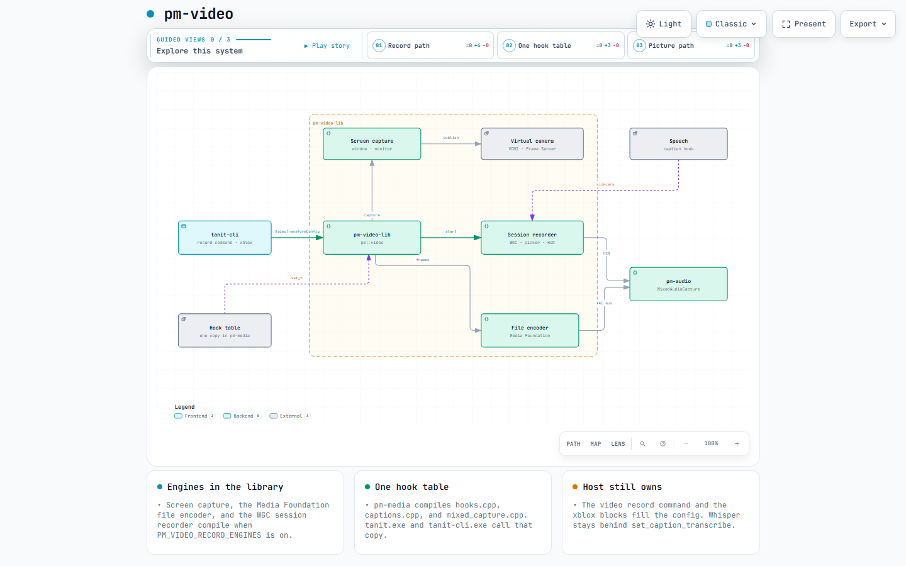
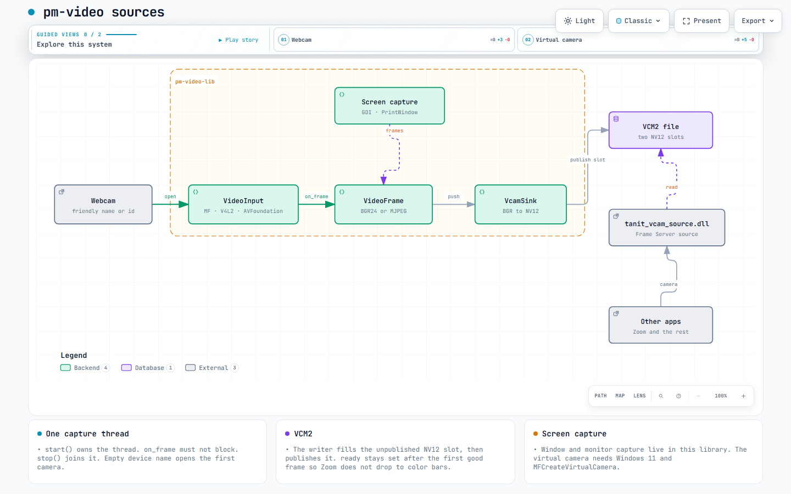
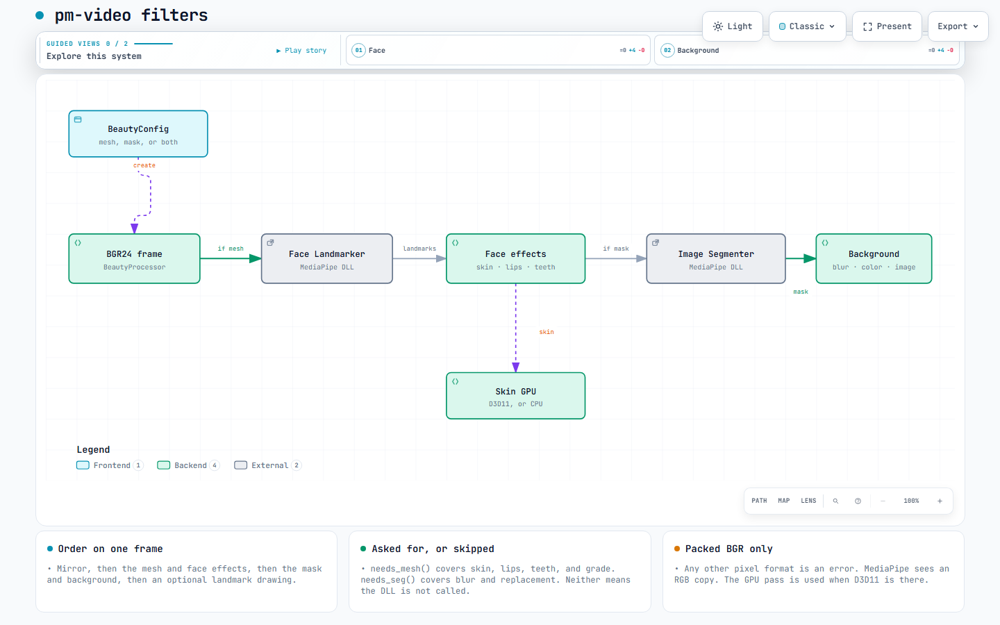
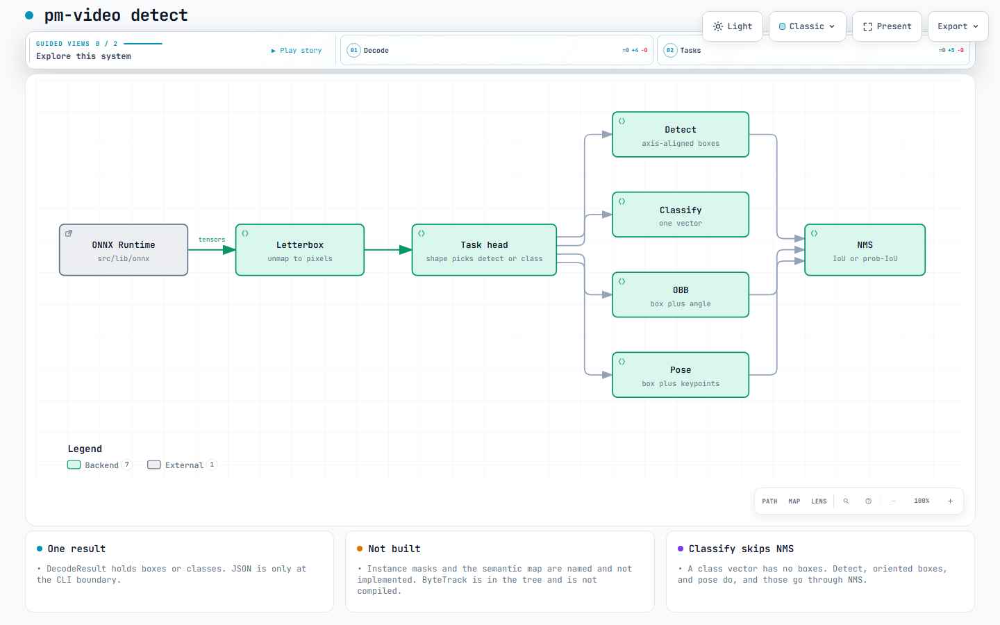

# pm-video

Portable video: tracking, detection, capture, encode, screen/window recording and filters.

`pm-video-lib` is the static library. `pm-video` is the JSON test CLI. A top-level Windows build also produces `tanit_vcam_source.dll` and `pm-video-nvenc.dll`. Namespaces stay `pm::video`, `pm::vcam`, `media::vdetect`, and `media::win::recorder`.

## What it does

- Frame model: `PixelFormat` and `VideoFrame` (`BGR24`, `RGB24`, `NV12`, `MJPEG`).
- Pixel helpers: hex RGB, polygon fill, dilate, erode, gaussian feather, BGR/Lab.
- Face Mesh index tables and normalized-to-pixel landmarks. `BeautyConfig` says whether a frame wants a mesh or a segmentation mask.
- Pause bits and recording status. A recording writes frames only when the pause mask is zero.
- Webcam capture (Media Foundation, V4L2, AVFoundation), stills, and JPEG encode.
- Virtual camera: VCM2 shared memory, BGR to NV12, the Media Foundation sink, and the Frame Server source DLL.
- Preview, capture idle, interactive zoom, and the camera overlay.
- MediaPipe face and segmentation (soft-loaded DLLs) and the D3D11 skin pass.
- ONNX YOLO decoders (`detect`, `classify`, `obb`, `pose`, `segment`) when `src/lib/onnx` is next to this package. Instance masks are named and not implemented. ByteTrack is in the tree and is not compiled.
- NVENC plugin (`packages/nvidia`), its loader, and the missing-plugin error check.
- MJPEG AVI writer, device-mode order, native-container and still-image path checks, and monotonic frame timestamps.
- Stream token, bind host, percent-encoding, and the dev-UI open URL.
- WebRTC signaling parse and the capability JSON scaffold.
- Caption sidecar entry point. The host installs the transcriber with `set_caption_transcribe`.
- Screen and window capture, the Windows frame pump, the Media Foundation file encoder, and the WGC session recorder (`PM_VIDEO_RECORD_ENGINES`, on in the host).
- Mixed mic, desktop, and camera audio through `pm-audio` (`MixedAudioCapture`). On the host that file is compiled into `pm-media` once, so the camera-name and cancel hooks are not copied into each executable.

## What stays on the host

The `video record` command loop and the xblox video blocks. They fill `VideoTransformConfig` and call the pump, the file encoder, and the session recorder. Speech stays on the host and is reached through `set_caption_transcribe`.

`video_host.cpp` installs paths, logging, the shortcut parser, and the camera-name hook. With `PM_VIDEO_HOST_SINGLETONS` and `PM_AUDIO_HOST_SINGLETONS`, `hooks.cpp`, `captions.cpp`, and `mixed_capture.cpp` are compiled into `pm-media` only. `tanit.exe` and `tanit-cli.exe` still link `pm-video-lib` for the engines, and they call that one hook table.

A standalone build reports WebRTC `compiled: false`. The host turns the scaffold on by compiling the library with `PM_VIDEO_HAS_WEBRTC=1` (and `PM_VIDEO_HAS_LIBDATACHANNEL=1` when that backend is linked).

## Architecture

Interactive copies are in [docs/architecture](docs/architecture/architecture.md).

`pm-video-lib` holds capture, screen and window capture, the file encoder, and the WGC session recorder. Mixed audio is `pm-audio`. The hook table lives in the host image. NVENC and the WebRTC scaffold sit in the library. Speech stays on the host.



`VideoInput` is Media Foundation, V4L2, or AVFoundation. Frames are BGR24 or MJPEG. `VcamSink` writes NV12 into a file-backed double buffer, and `tanit_vcam_source.dll` is the Frame Server camera other apps open.



`BeautyProcessor` wants packed BGR24. A mesh runs face effects. A person mask runs blur or replacement. Skin smoothing uses D3D11 when it is there.



YOLO heads decode to original image pixels. Auto can separate detect from classify. Oriented boxes and pose have to be named. Instance masks are not implemented. ByteTrack is in the tree and is not compiled.



## Dependencies

| Piece | Pin |
| --- | --- |
| C++ | 20 |
| nlohmann/json | v3.11.3, reused when the host already has the target |
| CLI11 | v2.4.2, test executable only |
| ONNX session headers | `src/lib/onnx` in the repo, not fetched |
| MediaPipe Tasks | `packages/mediapipe-tasks/bridge`, DLL soft-load |
| NVIDIA Video Codec SDK | `packages/nvidia` |

Fetched into this package's build tree when the target does not already exist: nlohmann and CLI11. ONNX Runtime, MediaPipe, and NVENC are the copies already in the repo.

## Build and test

From `packages/video.cpp`:

```text
npm run build:cpp
npm test
```

The test binary is `build/dev/pm-video` (`pm-video.exe` on Windows). `PM_VIDEO_CLI` overrides that path. `npm run build:cpp-fast` rebuilds with Ninja after a configure.

## CLI

Success is one JSON object on stdout and exit 0. Failure is `{"ok":false,"error","code","status"}` and exit 1. A usage error exits 2.

```text
pm-video color --hex #C45C6A
pm-video pause --reasons 0
pm-video status --state recording
pm-video landmark --x 0.5 --y 0.25 --width 100 --height 80
pm-video nv12
pm-video vcam
pm-video iou
pm-video nms
pm-video labels --file classes.txt
pm-video signal --json "{\"type\":\"offer\",\"sdp\":\"v=0\"}"
pm-video caps
pm-video modes
pm-video file --path clip.mp4
pm-video tick
pm-video nvenc --message "NVENC plugin not installed"
pm-video url --api http://127.0.0.1:9 --token abc --dev http://127.0.0.1:8
pm-video token
pm-video avi --out frame.avi
```

## Integration

```cmake
set(PM_VIDEO_RECORD_ENGINES ON)   # screen, encoder, session recorder
set(PM_VIDEO_HOST_SINGLETONS ON)  # hooks.cpp and captions.cpp compiled by the host
set(PM_AUDIO_HOST_SINGLETONS ON)  # mixed_capture.cpp compiled by the host
if(NOT TARGET pm-audio-lib)
  add_subdirectory(packages/audio.cpp ${CMAKE_BINARY_DIR}/pm-audio-lib EXCLUDE_FROM_ALL)
endif()
if(NOT TARGET pm-video-lib)
  add_subdirectory(packages/video.cpp ${CMAKE_BINARY_DIR}/pm-video-lib EXCLUDE_FROM_ALL)
endif()
target_sources(your_shared_image PRIVATE
  packages/video.cpp/src/hooks.cpp
  packages/video.cpp/src/captions.cpp
  packages/audio.cpp/src/mixed_capture.cpp)
target_link_libraries(your_target PUBLIC pm-video-lib)
```

Link `pm-video-lib`, not the `pm-video` executable. Public headers live under `include/pm/video/`. A standalone package build leaves the singleton options off, so `hooks.cpp` stays inside `pm-video-lib` and `npm test` does not compile the record engines. When the host enables WebRTC, set `PM_VIDEO_HAS_WEBRTC` on `pm-video-lib` before the capability JSON is compiled.

Host call sites keep their current includes (`video/pause_reason.hpp`, `video/detect/commons.hpp`, `core/video.hpp`). Those headers forward into this package. `core/video.hpp` forwards `VideoInput` and device enumeration to `pm/video/capture.hpp`.
